# RiftDeck

Roguelike táctico de cartas para 2 jugadores en el mismo teléfono. Unity **6000.6.7f1**, Android, solo horizontal, pixel art a 640×360 (escala ×3).

Abrir el proyecto con esa versión exacta de Unity. Las escenas están en `Assets/Scenes/` y se juega desde **Menu**.

## Pantallas

| Escena | Qué hay |
|---|---|
| `Menu` | Splash (solo la primera vez), menú con JUGAR, TIENDA, Configuración y Créditos, y el oro |
| `Combate` | La partida: enemigos por ronda, mano de cartas, maná con reserva, aumentos y arcanos |
| `Tienda` | Cosméticos con el oro del juego (dorsos, tapetes y efectos); sin dinero real |
| `Configuracion` | Sonido, vibración, calidad, velocidad de animación, nombres de los jugadores, cómo jugar y borrar progreso |
| `Creditos` | Equipo, arte de terceros con su autor, fuentes y universidad |
| `Resultados` | Ganador, puntos por ronda, oro ganado, REVANCHA y MENÚ |

"Pasa el dispositivo" no es una escena: es una pantalla que tapa el `Combate` entre turnos. La lógica de turnos y de fin de partida es del integrante 3. Aquí solo están las pantallas con nuestro estilo, conectadas a `CombateFalso` mientras tanto.

### Splash y menú
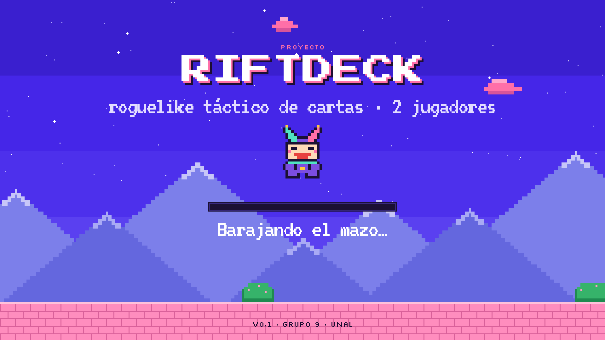
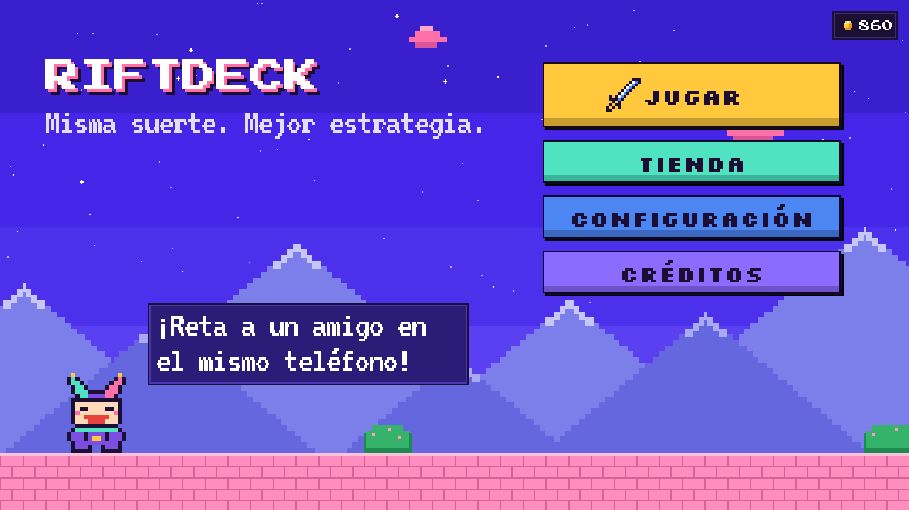

### Combate
Pasa el dedo por la mano para ver el detalle de cada carta (daño contra el enemigo actual). Arrastra o toca las cartas para ponerlas en la zona y pulsa JUGAR.

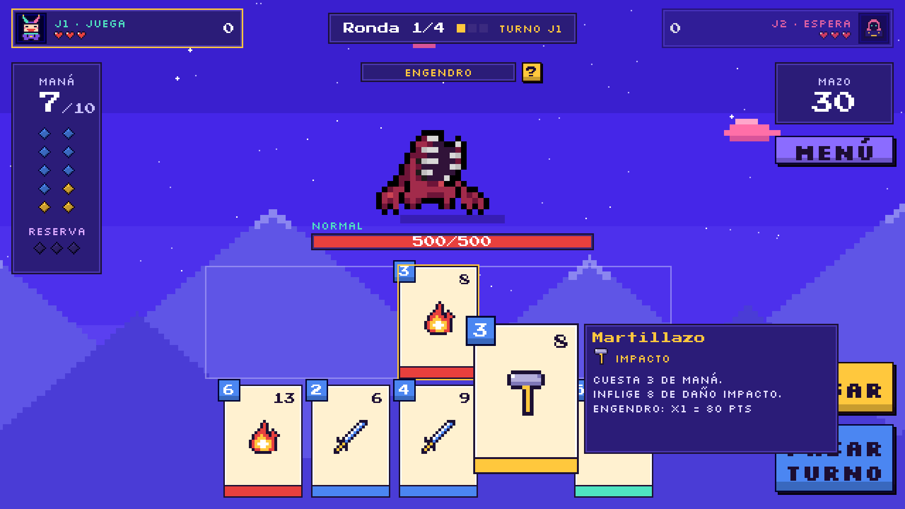

Cada enemigo tiene su gimmick. El Caballero puede bloquear todo el daño del turno siguiente:

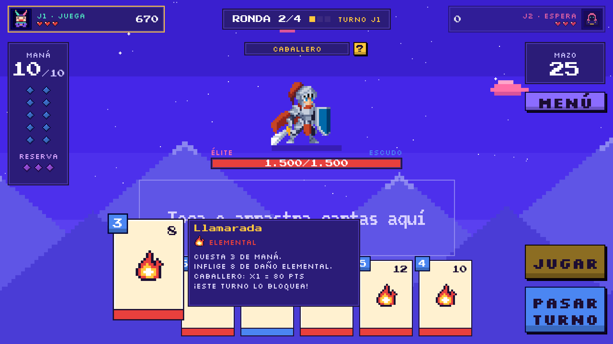

### Pasa el dispositivo
Al pulsar PASAR TURNO, el enemigo actúa y la pantalla se tapa por completo para que no se vea la mano del otro. El nombre va en el color de quien recibe el teléfono y la partida sigue cuando toca ESTOY LISTO.

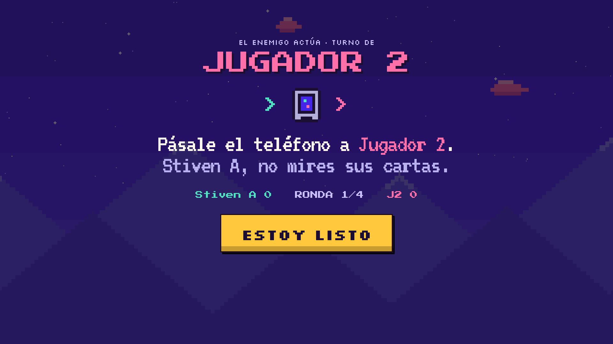

### Selección de aumento (estilo TFT)
Hay 3 por partida (plata, oro y prismático, el último siempre prismático) y los dos jugadores reciben las mismas opciones. El prismático tiene un relleno iridiscente con relieve y se inclina con el dedo.

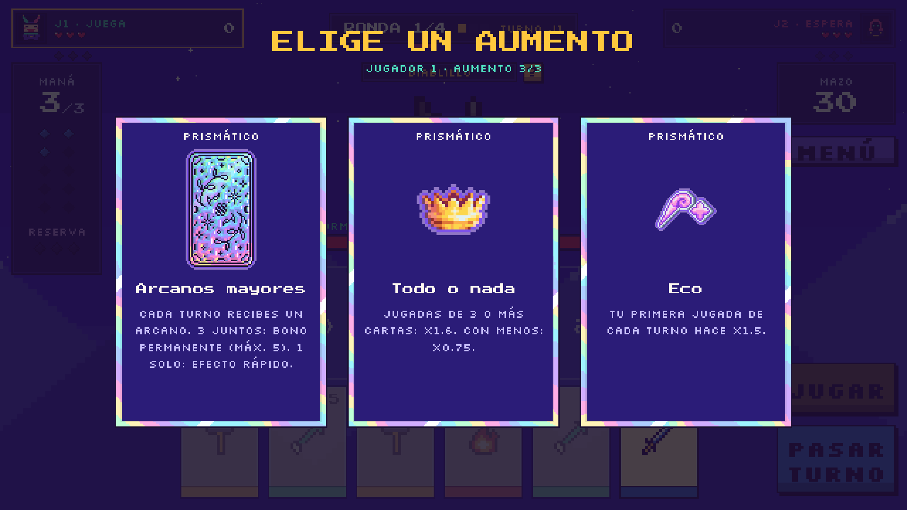

### Arcanos mayores (aumento prismático)
Llega un tarot por turno. Si juegas 1, duplica el daño de su tipo. Si juegas 3, forman un trío con bono permanente (máximo 5 tríos).

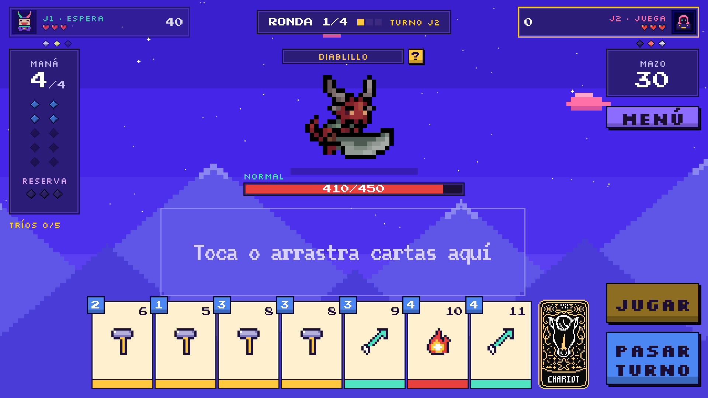
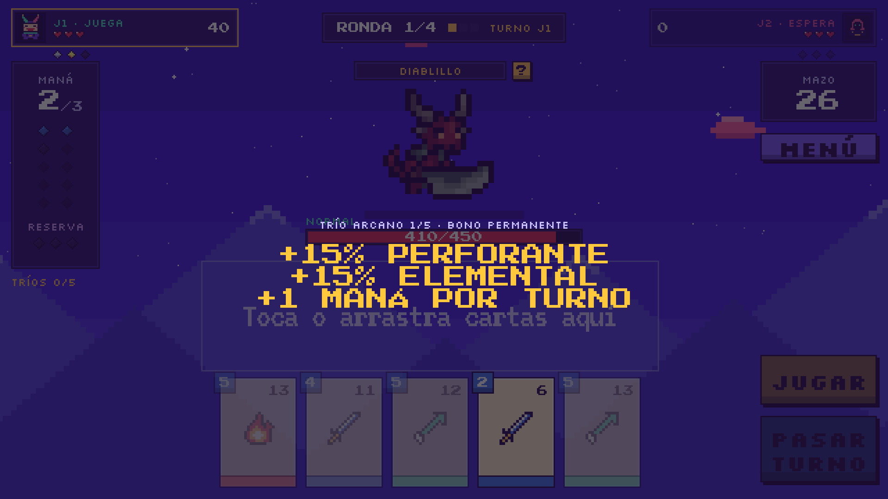

### Otros prismáticos y Todo o nada
- **Hechizos prohibidos:** cada turno hay un 12.5 % de robar un hechizo, y sube un 2.5 % por cada turno sin suerte hasta el 25 %. Ahí sale el 5 o el 6 (85/15), y si tampoco sale, el turno siguiente llega seguro el Cataclismo. Cada elemento distinto en la jugada duplica el daño.
- **RAAWRMERICA!!:** esconde 3 armas en el mazo. Cada arma jugada se suma al Arsenal, que con 5 suelta una lluvia de balas y con 7 una de misiles. Si juntas las 6 armas distintas, cae una bomba nuclear con hongo. Quien le hace el 20 % de la vida a un enemigo gana un arma.
- **Póker:** la mano pasa a ser de cartas de póker y el daño sale de la mano que armes (pareja, color, full...). Cada palo es un tipo de daño. A veces sale el comodín (prismático): vale por la carta que mejor complete la mano.
- **Todo o nada (oro):** jugar toda la mano o pasar sin jugar sube el multiplicador de daño +0.2 cada vez.

Los marcos son de Deckbuilder Kit Free y Pixel Cards Lite.

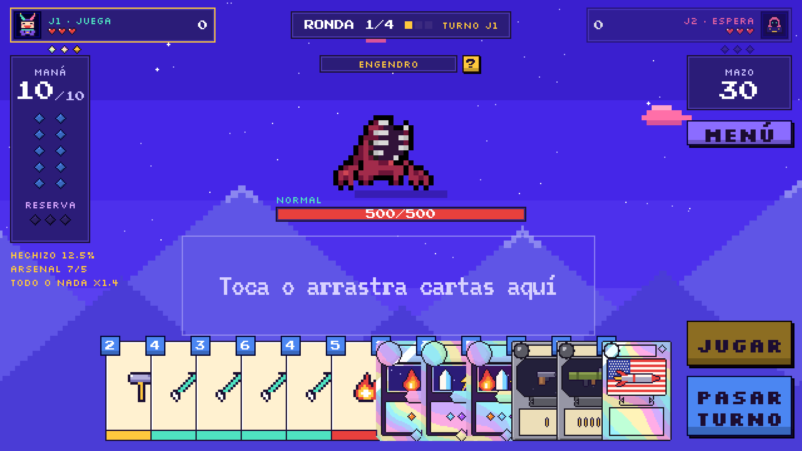
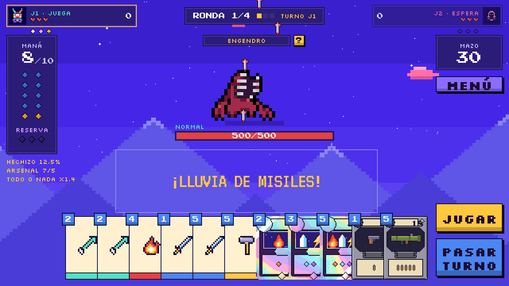
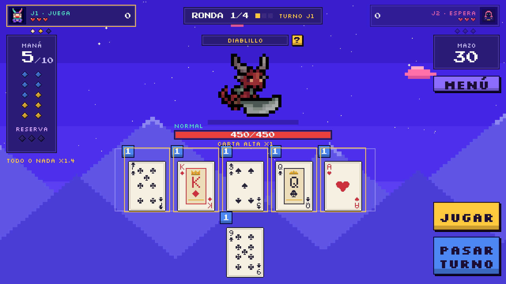

### Lista de aumentos
Los marcos de plata y oro son de metal pulido (shader `UIMetal`, materiales `Plata` y `Oro`). Los prismáticos usan el arcoíris (`UIPrismatico`).

| Calidad | Aumento | Qué hace |
|---|---|---|
| Plata | Filo afilado | +10 % de daño con todas tus cartas |
| Plata | Mano grande | Robas 1 carta más en cada mano |
| Plata | Alcancía | Empiezas cada turno con +1 de reserva |
| Oro | Golpe crítico | Cada jugada tiene 25 % de probabilidad de hacer el doble |
| Oro | Maná rápido | Tu maná máximo sube de 2 en 2 |
| Oro | Especialista | +30 % de daño con el tipo al que el enemigo es débil |
| Oro | Todo o nada | Jugar toda la mano o pasar sin jugar: +0.2 al multiplicador, acumulable |
| Prismático | Arcanos mayores | Un arcano por turno. 3 juntos: bono permanente (máx. 5). 1 solo: efecto rápido |
| Prismático | Hechizos prohibidos | 12.5 % por turno de robar un hechizo (+2.5 % por turno sin suerte). Cada elemento distinto x2 |
| Prismático | RAAWRMERICA!! | 3 de las 6 armas van a tu mazo. Arsenal: 5 balas, 7 misiles, las 6 distintas = bomba nuclear |
| Prismático | Póker | La mano pasa a ser de póker y el daño sale de la mano que armes. Puede salir el comodín |

**Total: 11** (3 de plata, 4 de oro y 4 prismáticos).

#### ¿Cuántos hacen falta para que haya variedad?
En cada partida hay 3 ofertas, una de cada calidad, y cada oferta muestra 3 aumentos de esa calidad. Con *n* aumentos en una calidad:

| *n* por calidad | Tríos distintos posibles | Cada aumento sale en… | Misma oferta que la partida anterior |
|---|---|---|---|
| 3 | 1 | todas las partidas | siempre |
| 4 | 4 | 3 de cada 4 partidas | 25 % |
| 5 | 10 | 3 de cada 5 partidas | 10 % |
| **6** | **20** | **1 de cada 2 partidas** | **5 %** |
| 8 | 56 | 3 de cada 8 partidas | 1.8 % |

- **Mínimo recomendado: 6 por calidad, 18 en total.** Así cada aumento sale en la mitad de las partidas y casi nunca se repite la misma oferta.
- **Faltan 7:** 3 de plata (hoy la oferta de plata es siempre la misma), 2 de oro y 2 prismáticos.
- Con 8 por calidad (24 en total) ya se siente como TFT, donde no sabes qué te va a tocar.

### Tienda
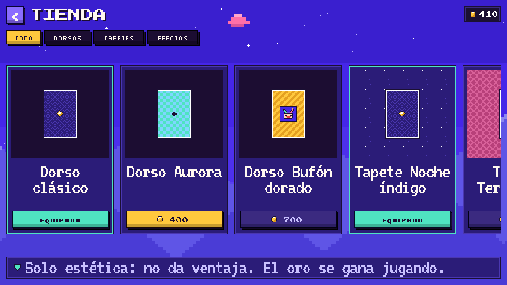

Comprar pide un segundo toque. Si te falta oro, te avisa cuánto:

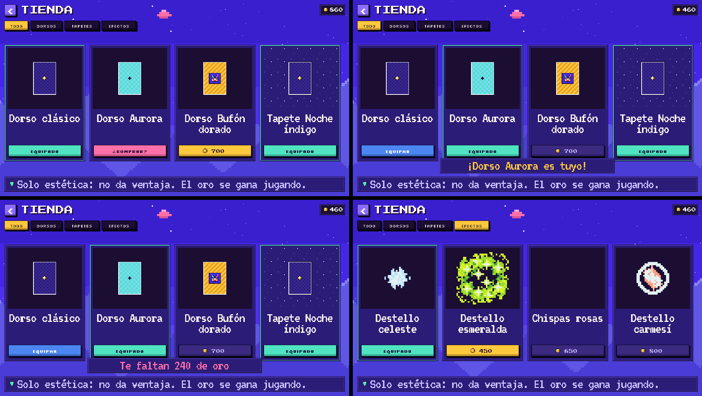

### Resultados
Se abre al terminar la ronda 4. Gana quien sume más puntos en total. La tabla dice quién ganó cada ronda con su nombre (no solo con el color) y la partida da +60 de oro para la Tienda.

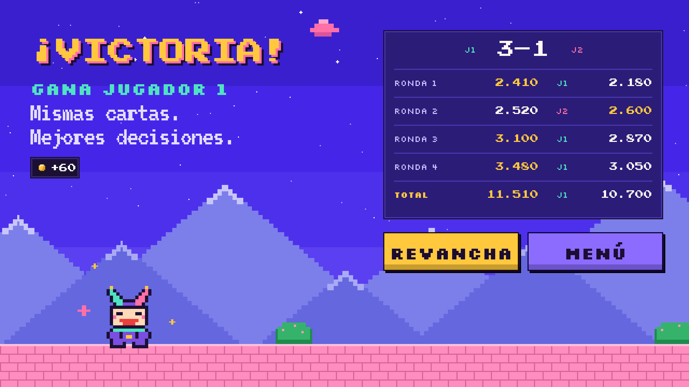

### Configuración
Todo se guarda en el teléfono (`Ajustes`, con PlayerPrefs). Los nombres de los jugadores (hasta 8 letras) salen en el HUD, en "Pasa el dispositivo" y en Resultados. La velocidad x2 acelera las animaciones del combate. "Borrar progreso" pide un segundo toque y solo borra el oro y los cosméticos.

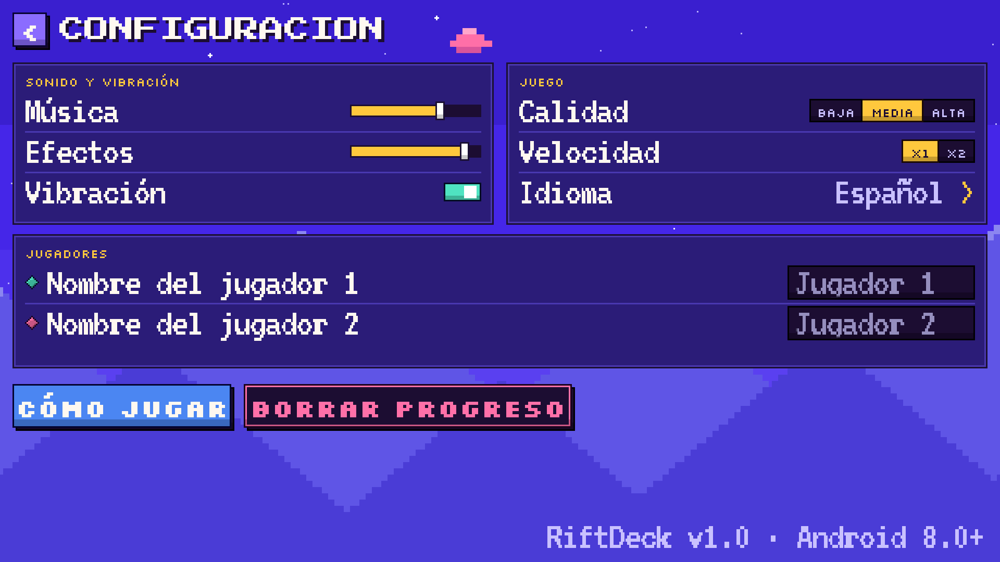
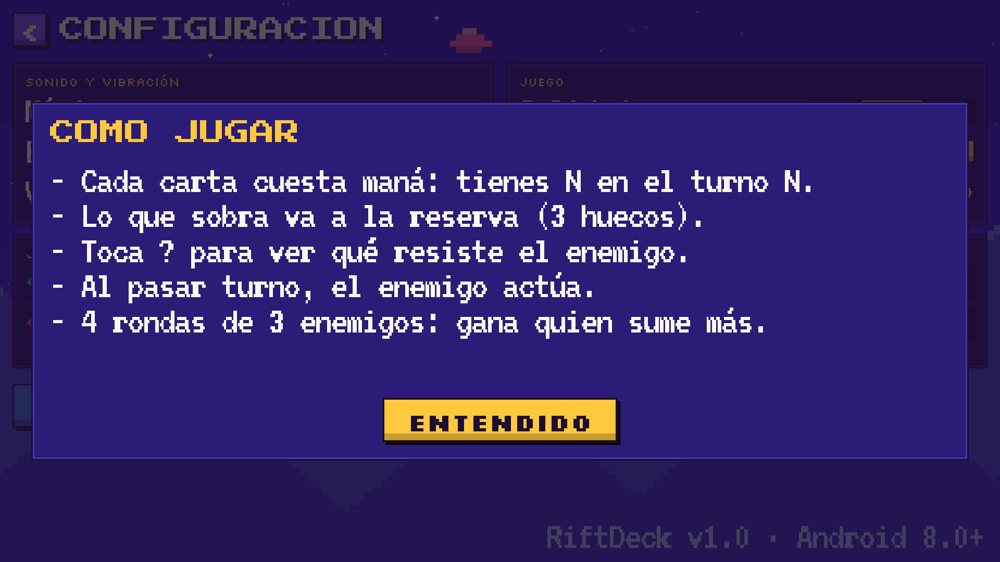

### Créditos
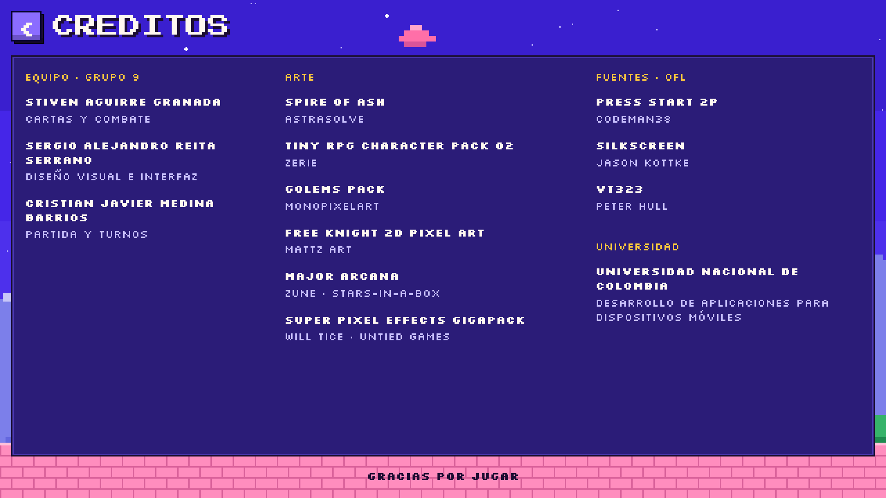

## Notas para el equipo
- Los valores de cartas, enemigos, aumentos y precios son **provisionales** (`CombateFalso` usa datos de prueba) hasta que el integrante 1 defina el combate.
- El oro se guarda en el teléfono (`Inventario`). Resultados ya suma el de cada partida con `ResultadoPartida.CobrarOro()`.
- **Para el integrante 3:** al terminar la partida, llama a `ResultadoPartida.Guardar(puntosJ1PorRonda, puntosJ2PorRonda)` y carga la escena `Resultados`. Para cambiar de turno, usa `PasaDispositivo.Mostrar(...)`: tapa la pantalla, corre tu cambio de mano ya tapada y espera a ESTOY LISTO. Mira cómo lo hace `CombateFalso.CambioDeTurno`.
- El arte de terceros está en `Assets/Art/Terceros/`. Varios packs no permiten redistribuir los archivos sueltos, así que **Claude sugiere hacer privado el repositorio** para no arriesgarnos a un reclamo por copyright.
